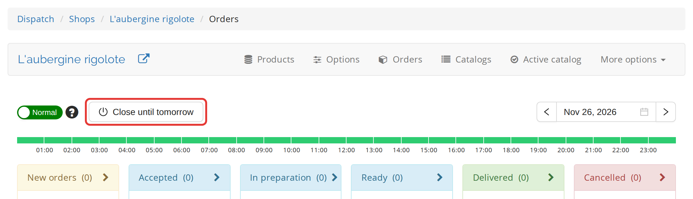
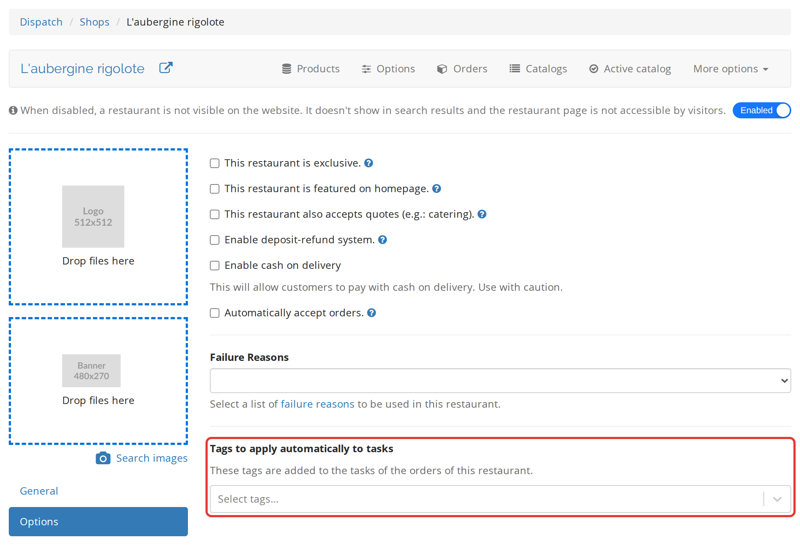
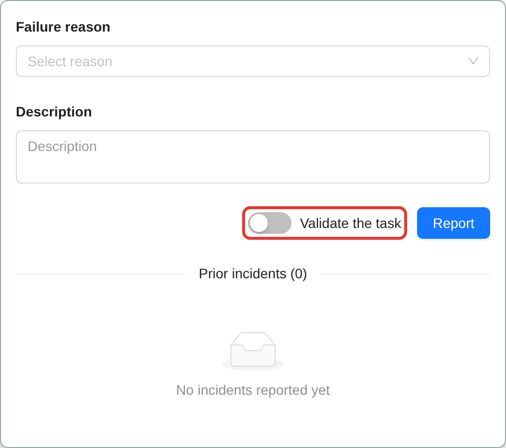

This note covers everything since 6.23.0 (versions 6.23.1 to 6.26.0), except the referral program, loyalty program and marketing campaigns.

## New

### Delivery imports: import a spreadsheet whatever its column names

You no longer need to rename the columns of a file before importing it. After you upload it, a **Match the columns of your file** screen shows the file as a spreadsheet, with its first rows, and a list above each column to say what it holds: **Pickup address**, **Dropoff time slot**, **Packages**, **Weight (kg)**, **External reference** and so on. The columns CoopCycle recognises are already filled in: check them, set the others, and choose **do not import this column** for the ones you don't need.

The import starts once you confirm. If you uploaded the wrong file, click **Drop this file**. An import left on this screen is dropped after a day, and nothing from it is imported. To come back to it before then, click **Match the columns** next to it in the list of imports.

A new **External reference** column sets the delivery's own reference, the one shown in the list of deliveries.

### Delivery imports: follow an import and cancel it

The list of imports has a new **Progress** column. While a file is being read, it shows how many lines are done out of the total, how many have errors, and roughly how long is left. A large file can take hours, mostly to find the addresses on the map, so you can now tell a slow import from a stuck one.

While the file is being read, you can **Cancel** the import: no delivery from the file is created. Once it reaches "saving the deliveries", it can no longer be cancelled.

### Delivery imports: cancel every delivery of an import

Once an import is done, **Cancel the deliveries** cancels all the deliveries it created, for example after importing the wrong file or the same file twice. A window first tells you how many deliveries and which file. Each delivery is cancelled with its order, and its tasks too, even those already assigned to a courier. Deliveries already under way (a task started, done or failed) are left as they are. This can't be undone.

The **Progress** column then shows how many deliveries are cancelled and how many were left as they are.

### Delivery imports: faulty files are rejected in seconds

A file missing a required column, or with rows that can't be imported (a missing address, an unreadable time slot, an invalid phone number, a pickup after its drop-off…), is now rejected within a few seconds, with every faulty line listed. Before, these problems only showed up after every address had been looked up, which could take hours.

Deliveries from a file are now saved all at once: if saving fails, none are created, and the error tells you to import the file again. Before, an import that failed halfway left some deliveries created and others not.

### Foodtech dashboard: close a restaurant until tomorrow

A **Close until tomorrow** button now sits next to the rush mode switch, on the orders dashboard of each restaurant. Customers can no longer order from the restaurant for the rest of the day. Orders already placed are not affected. Once it is closed, the button is replaced by a **Closed until tomorrow** label. Restaurant owners see the button on their own dashboard too.

Before, closing for the day meant adding closing dates in the restaurant's opening hours, or using the mobile app.

### Restaurants: tags added to the tasks of their orders

Like stores, restaurants can now have tags. Set them in the **Options** tab of the restaurant, under **Tags to apply automatically to tasks**. They are added to the tasks of every order from this restaurant, so dispatchers and couriers can spot them, for example "pizza" or "liquid". For an order from several restaurants of a hub, the tags of all of them are added. Only admins see this field.

### Dispatch: validate the task when reporting an incident

When you report an incident on a task (right-click the task, then **Report an incident**), a **Validate the task** switch now marks the task as done at the same time, as couriers can already do from the app. If the task can't be validated, for example because an earlier task isn't done, the incident is still reported and the reason is shown. The switch is greyed out on a task that is already done or cancelled.

### Dispatch: incoming carts on the map

The dispatch map can show where orders are about to come from: a pulsing marker for each customer going through checkout, and a sign when their order is placed. A counter in the top bar tells how many carts are in checkout and how many are at the payment step. It is a forecast, not work to assign.

Turn it on in the dispatch settings, with **Show incoming carts on the map**.

> [!NOTE]
> This feature may not be available on every instance yet. If you don't see the setting, it hasn't been turned on for your cooperative.

### Forms: give a name to each delivery form

Delivery forms can now have a **Name**, only visible to administrators, to tell the forms apart. It is shown in the list of forms, with the form's identifier below it, where pricing rules and package sets list the forms that use them, and in the homepage editor. Existing forms keep showing their identifier until you name them.

### Shift planning: edit a shift template

Shift templates can now be changed with **Edit template**, instead of being deleted and created again.

## Changed

- **Shift planning:** couriers no longer see the shifts of a week that hasn't been published yet, in the app or in their calendar. They are notified of their shifts when the week is published.
- **Fleet management:** a vehicle no longer needs a color. One is picked at random if you leave it empty.
- **Delivery imports:** a delivery that no pricing rule matches is still created, with a price of 0 and an incident so that a dispatcher reviews it. Before, it was created without an order, could never be priced, and the import was shown as failed.
- **Delivery imports:** the dispatch board reloads once when an import is saved, instead of once for every task of the file.
- **Dispatch:** the board now gets its live updates right away, even while the server is busy with long jobs like imports.
- **Maintenance:** store accounts can keep using CoopCycle while the instance is in maintenance mode.

## Fixed

- **Pricing:** in the per-package price editor, changing the "starting from N packages" field replaced the unit price with a wrong value, while the field still showed the right one.
- **Delivery form:** photos added to a task are now made smaller before they are sent. Photos taken with a phone were often too large, and the upload failed with just "Failed to upload". Other files over 4.5 MB are refused with a clear message.
- **Delivery imports:** the window listing the errors of an import opens right away, with a spinner while the errors load. When an import failed while the page was open, its link now reads "see the errors" without reloading the page.
- **Photos and signatures:** the photos, signatures and incident photos of a task can now only be opened by people allowed to see that task or incident.
- **Checkout:** going back from the payment page no longer leaves the page stuck loading. The time slot list scrolls properly again.
- **Checkout:** the En Boîte Le Plat checkbox showed as an empty box with its text squeezed inside, and its link didn't work.
- **Restaurant page:** a product description with a very long word or link no longer pushes the price and the **+** button out of the card.

## Transporters (EDI)

For cooperatives that receive deliveries as EDI files from a transporter:

- A file that can't be imported is now set aside on its own, and the other files are still imported. Before, one bad file kept every file of the run on the transporter's server, to be pulled again each time.
- The files that are rejected are emailed to the administrator email set in the settings, attached as they were received.

---

**Full changelog:** https://github.com/coopcycle/coopcycle-web/compare/v6.23.0...v6.26.0
